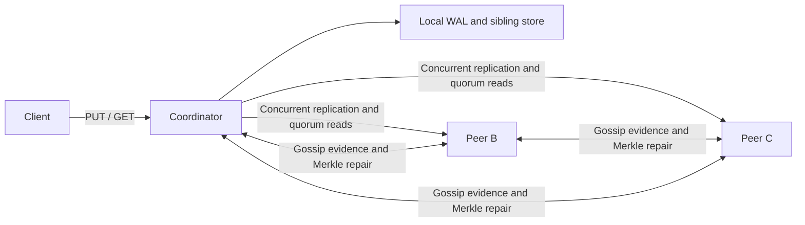

# Distributed Key-Value Store in Go

[](https://github.com/ParimalMate/go-kvstore/actions/workflows/ci.yml)

An educational Dynamo-style replicated key-value store with a durable write-ahead
log, configurable quorums, vector-clock conflict detection, gossip failure
detection, and Merkle-tree anti-entropy. It preserves concurrent values instead
of silently selecting a winner and repairs replicas that missed writes.

Milestones 1–6 are implemented and independently reviewed. The Milestone 7
fault-injection harness and its local results are described in
[Testing](docs/TESTING.md) and the [seed matrix](docs/chaos-results.md).
This is a learning project, not a production database.

## Features

- Durable local writes before replication; WAL replay after restart.
- Concurrent fan-out with early replies after W successful writes.
- Quorum reads across R responses, including the local node.
- Vector-clock siblings and HTTP 300 for unresolved concurrent values.
- Gossip heartbeat evidence and local alive/suspect/dead decisions.
- Fixed-shape SHA-256 Merkle trees with 4096 leaf buckets.
- Bounded background repair triggered by timers, recovery events, or an API call.
- A real-process harness with replayable fault schedules and negative controls.
- Go standard library only; Python verification scripts have no external dependencies.

## Architecture



All nodes have the same roles. The node receiving a client request becomes that
request's coordinator. Peer membership is static: gossip learns identities but
does not discover new dialable addresses or change quorum sizes.

## Requirements

- Go 1.22 or newer.
- Python 3.10 or newer for the verification scripts.
- Bash, curl, and POSIX signals for cluster scripts (macOS/Linux).
- A C toolchain supported by Go when using `-race`.

## Quick start

From a fresh checkout, build and start the three-node cluster:

```bash
go build ./...
bash run-cluster.sh
```

Keep that terminal open. The launcher uses ports 8081–8083, W=2/R=2, and
separate `n1.log`, `n2.log`, `n3.log` WALs. Operational logs go to `n1.out`,
`n2.out`, and `n3.out`. Existing WALs are replayed; use a fresh directory for
these examples. In another terminal:

```bash
curl -i -X PUT http://localhost:8081/kv/greeting --data-binary 'hello'
curl -i http://localhost:8082/kv/greeting
```

Expect HTTP 200 and `hello` from GET. To deliberately demonstrate a conflict,
use the peer API to supply two concurrent clocks on the same node:

```bash
curl -i -X PUT http://localhost:8081/internal/kv/demo-conflict \
  -H 'Content-Type: application/json' \
  --data-binary '{"value":"Mumbai","vc":{"demo-a":1}}'
curl -i -X PUT http://localhost:8081/internal/kv/demo-conflict \
  -H 'Content-Type: application/json' \
  --data-binary '{"value":"Pune","vc":{"demo-b":1}}'
curl -i http://localhost:8081/kv/demo-conflict
```

GET returns HTTP 300 with both `{value, vc}` objects. This controlled example
injects concurrent versions directly; the cluster and chaos scripts create
conflicts using actual network partitions. Resolve through n1, which knows both:

```bash
curl -i -X PUT http://localhost:8081/kv/demo-conflict --data-binary 'Resolved'
curl -i http://localhost:8081/kv/demo-conflict
```

Expect one HTTP 200 value. Press Ctrl+C in the launcher terminal to stop all
three processes. Keep each node's ID and WAL together when restarting.

For an independent single node:

```bash
go build -o server ./cmd/server
./server --id solo --port 8080 --data solo.wal --w 1 --r 1
```

## API

Keys and values are UTF-8 text. Empty values, Unicode, NUL and newline are
supported. Binary values are rejected. External PUT accepts up to 1 MiB.

| Method and path | Purpose / response |
|---|---|
| `PUT /kv/{key}` | Raw value; 200 once W durable acknowledgements arrive, 503 if quorum fails |
| `GET /kv/{key}` | 200 plain value, 300 JSON siblings, 404 absent, 503 insufficient responses |
| `PUT /internal/kv/{key}` | JSON `{value,vc}`; apply vector-clock dominance |
| `GET /internal/kv/{key}` | Full sibling array, empty array for an absent key |
| `POST /internal/gossip` | Push-pull `{from,members}` evidence |
| `GET /internal/members` | Local liveness view and unreached seeds |
| `POST /internal/ae/nodes` | Tree hashes at `{level,indexes}` |
| `POST /internal/ae/buckets` | Key/hash listings at `{indexes}` |
| `POST /internal/ae/run` | Optional `{peer}`; returns repair reports |
| `GET /internal/ae/status` | Totals and last report per peer |

An explicit manual repair target must exactly match a configured `--peers`
entry; other targets return 400. An empty body repairs currently eligible peers.
Internal endpoints are unauthenticated and must not be exposed to untrusted
clients. See [Protocols](docs/PROTOCOLS.md) for formats, limits and error cases.

## Flags

| Flag | Default | Meaning / constraints |
|---|---|---|
| `--id` | `n1` | Unique ID: 1–64 ASCII letters, digits, `.`, `_`, `-`; starts alphanumeric |
| `--port` | `8080` | Numeric listening port |
| `--data` | `kvlog` | Per-node WAL path |
| `--peers` | empty | Comma-separated `host:port` addresses |
| `--w` | `2` | Required write acknowledgements, including local |
| `--r` | `2` | Required read responses, including local |
| `--gossip-interval` | `1s` | 10ms–1m |
| `--suspect-after` | `10s` | At least 3 intervals; allow more margin for partial failures |
| `--dead-after` | `20s` | Greater than suspect threshold |
| `--ae-interval` | `30s` | 0 disables automatic repair; otherwise 1s–1h |
| `--ae-max-keys` | `1000` | 1–100000 candidate keys per cycle |
| `--ae-initial-delay` | `5s` | 0–interval when enabled; ignored when disabled |

N is `len(peers)+1`; startup requires `1 <= W,R <= N` and `W+R>N`.
The common three-node configuration is W=2/R=2. With no peers, use W=R=1.
Disabling automatic repair keeps tree endpoints and manual repair available.

## How it works

**WAL.** A node appends and syncs each changing write before exposing it in
memory. Replay uses the same dominance rule as live traffic. A torn final
record is truncated; stale and identical writes do not grow the WAL.

**Quorums.** Writes persist locally, then fan out to every peer. The handler
replies after W successes while remaining attempts finish on their own timeout.
Reads collect R answers and prune dominated versions. W+R>N guarantees set
overlap for acknowledged writes; it does not provide transactions or linearizability.

**Vector clocks.** The coordinator joins its local sibling clocks and increments
its own counter. Replicas drop dominated versions and retain concurrent ones.
Timestamps are informational. A plain PUT cannot convey client history that
the coordinator has never seen, so sequential client writes can still conflict.

**Gossip.** Each process advances its own heartbeat and exchanges evidence with
one random configured peer per round. Local monotonic time determines liveness;
a process generation distinguishes restarts. Quorum code never consults gossip.

**Anti-entropy.** Canonical hashes exclude timestamps and zero clock entries.
Trees are immutable snapshots cached by store revision. Comparison descends
only mismatching branches, validates bucket listings, then pulls/applies/pushes
versions using the ordinary dominance rule. One worker serializes bounded
cycles; gossip gates periodic selection and enqueues recovered peers.

## Testing

```bash
scripts/verify-all.sh --quick
scripts/verify-all.sh
python3 scripts/chaos-cluster.py --seed 11 --duration 60
```

Full mode includes cluster scripts, both negative controls, and three chaos
seeds. Per-check logs are in `verify-logs/`; event histories, node logs and
summaries are in `chaos-results/`. These generated artifacts are ignored by Git.

The harness uses a **replayable fault schedule**, not deterministic execution.
See [Testing](docs/TESTING.md) for invariants, failure controls and limitations,
and [local results](docs/chaos-results.md) for measured seed outcomes.

## Limits and further reading

- No deletes/tombstones, transactions, authentication, TLS, read repair or hinted handoff.
- No automatic conflict resolution or client-supplied causal context.
- Static membership and fixed tree shape; snapshots rebuild after changed revisions.
- Loopback tests and SIGKILL do not simulate hardware failure or power loss.
- A wiped node must catch up before reusing its old ID for new writes.

Details: [Design](docs/DESIGN.md), [Protocols](docs/PROTOCOLS.md),
[Limitations](docs/LIMITATIONS.md), [Milestone diary](docs/MILESTONES.md).

Licensed under the [MIT License](LICENSE).
